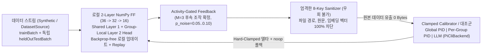

# llmCalibratorSim (한국어판)

> [English Version (README.md)](./README.md)

원본 텍스트·파일명·임베딩 벡터 유출 **$0\text{ Bytes}$ (Sovereignty & 상용 LLM ToS 준수)** 조건하에서, 오직 익명화된 시계열 성과 배열만 읽는 **Clamped LLM Meta-Calibrator**가 결정론적 **Global PID** 및 **Per-Group PID** 대조군 대비 어떤 드리프트·구조적 고장에서 실제로 우위를 가지는지 검증하는 초경량 순수 Python(`Python 3.12 + NumPy`) 시뮬레이션 테스트베드입니다.

---

## 1. 아키텍처 및 Sovereignty 경계



1. **로컬 Forward-Forward 분류기 (`ffModel.py`)**: Backpropagation 없이 동작하는 2-Layer NumPy FF 네트워크(`Shared Layer 1` [36→32] + `Group-Local Layer 2 Head` [36→16] with class skip-connection) 및 Jev-like Temperature Softmax 구현.
2. **3대 고장 주입 및 복합 충격 환경 (`driftEnv.py`, `stressTrajectory.py`)**: `global_decay`(전역 감쇠), `subgroup_drift`(`doc_hwpx` 그룹 특이 이동), `structural_label_swap`(`doc_slide` 내부 카테고리 역전) 및 14-사이클 `compound_shock` 스트레스 테스트와 Activity-Gated Implicit Feedback($M = 3$, $p_{\text{noise}} = 0.05$ 오프라인 / $0.10$ 궤적) 시뮬레이션.
3. **엄격한 Outbound Sanitizer (`sanitizer.py`)**: 8개 화이트리스트 키(`decision_id`, `ext_enum`, `pred_cat`, `actual_cat`, `outcome`, `raw_goodness_G`, `confidence_p`, `timestamp_s`) 외 모든 키, 파일 경로, 장문 텍스트, 임베딩 벡터, `bool`-as-`int`, 비유한 실수 입력 시 즉시 `SovereigntyViolationError` 발생 (`bypass` 플래그 없음).
4. **Hard-Clamped Calibrator 대조군 (`calibrators.py`, `runBenchmark.py`)**: `GlobalPidCalibrator`, `PerGroupPidCalibrator`, `ClampedLlmCalibrator`(오프라인 `DeterministicRuleOracle` 및 실 LLM `PiCliBackend`)를 비교하며 Hard Clamping 및 깨진 JSON에 대한 `noop` 폴백을 강제.

| 파라미터 | 사이클당 변화폭(Delta) 상하한 | 절대값 상하한 | JSON 파싱/스키마 오류 시 폴백 |
| :--- | :---: | :---: | :--- |
| 임계치 $\theta_g$ | $[-0.15, +0.15]$ | $[0.2, 5.0]$ | `recommended_action = "noop"` (변화량 0) |
| Positive 가중치 $\alpha_g$ | $[-0.20, +0.20]$ | $[0.2, 3.0]$ | `recommended_action = "noop"` (변화량 0) |
| Negative 가중치 $\beta_g$ | $[-0.20, +0.20]$ | $[0.2, 3.0]$ | `recommended_action = "noop"` (변화량 0) |
| Temperature $T_g$ | $[-0.20, +0.20]$ | $[0.2, 5.0]$ | `recommended_action = "noop"` (변화량 0) |

---

## 2. 벤치마크 실측 결과

### 2.1 오프라인 5-Seed 벤치마크 (`seeds=42..46`, `8 cycles`, `elapsedSec=4.409s`, `10/10 tests OK`)

| 시나리오 | Calibrator | 드리프트 전 Acc | 드리프트 직후 Acc (Cycle 1) | 최종 Acc | 최종 ECE | 회복 사이클 |
| :--- | :--- | :---: | :---: | :---: | :---: | :---: |
| `global_decay` | `global_pid` | 0.980 | 0.983 | **0.577** | 0.249 | 1.00 |
| `global_decay` | `per_group_pid` | 0.980 | 0.983 | 0.569 | **0.184** | 1.00 |
| `global_decay` | `clamped_llm` (Oracle) | 0.980 | 0.983 | 0.556 | 0.234 | 1.00 |
| `subgroup_drift` | `global_pid` | 0.980 | 0.742 | 0.967 | 0.109 | 7.20 |
| `subgroup_drift` | `per_group_pid` | 0.980 | 0.742 | 0.981 | 0.110 | 6.20 |
| `subgroup_drift` | `clamped_llm` (Oracle) | 0.980 | 0.742 | **0.988** | **0.077** | **4.40** |
| `structural_label_swap` | `global_pid` | 0.980 | 0.737 | 0.540 | 0.387 | 8.00 |
| `structural_label_swap` | `per_group_pid` | 0.980 | 0.737 | 0.738 | 0.206 | 8.00 |
| `structural_label_swap` | `clamped_llm` (Oracle) | 0.980 | 0.737 | **0.929** | **0.141** | **7.00** |

### 2.2 `pi-shell` 기반 실 LLM `Unit 4` 대조 결과 (`seed=42`, `6 cycles`)

| 모델 (`OPENGATEWAY/...`) | 소요 시간 | JSON 파싱률 (A / B / C) | `global_decay` Acc | `subgroup_drift` Acc | `structural_label_swap` Acc | ECE (A / B / C) |
| :--- | :---: | :---: | :---: | :---: | :---: | :---: |
| *대조군: `per_group_pid`* | — | — | **0.365** | 0.948 | 0.750 | 0.596 / 0.109 / 0.198 |
| `z-ai/glm-5.3-flash-ultrafast` | **26.289s** | **1.00 / 1.00 / 1.00** | 0.354 | **0.958** | **0.948** | 0.601 / 0.058 / 0.117 |
| `deepseek/deepseek-v4.1-flash-eco` | 90.329s | 1.00 / 0.83 / 1.00 | **0.365** | 0.917 | **0.948** | 0.601 / **0.030** / 0.117 |
| `google/gemini-3.5-flash-lite` | 28.104s | **1.00 / 1.00 / 1.00** | 0.125 | 0.854 | **0.948** | 0.788 / 0.059 / 0.117 |
| `openai/gpt-4.1-nano` | 40.444s | 0.83 / 0.67 / 0.83 | 0.208 | 0.760 | 0.771 | 0.638 / 0.141 / 0.168 |

*(참고: `sionic-ai/jev-omni`는 `OPENGATEWAY`에서 `400 unsupported_endpoint: use /v1/decisions`를 반환해 `/v1/chat/completions` 기반 JSON Calibrator 역할에는 부적합함이 확인되었습니다.)*

### 2.3 장기 14-사이클 궤적 및 Overshoot 스트레스 테스트 (`stressTrajectory.py`, `seed=42`, `12/12 tests OK`)

#### PID Gain Sweep (`global_decay` + `subgroup_drift` + `label_swap` + `compound_shock`)
| `kp` | `ki` | 최종 Train Acc | 최종 Held-Out Test Acc | 최고 Test Acc | 최대 Train-Test Gap | $\theta$ 부호 반전 | Overshoot |
| :---: | :---: | :---: | :---: | :---: | :---: | :---: | :---: |
| 0.50 | 0.10 | 0.188 | 0.125 | 1.000 | 0.104 | 1 | `True` (추종 지연) |
| 1.50 | 0.30 | 0.250 | 0.240 | 1.000 | 0.021 | 1 | `True` (추종 지연) |
| 3.50 | 0.80 | 0.250 | 0.240 | 1.000 | 0.062 | **3** | `True` (진동 발생) |
| 8.00 | 2.00 | 0.667 | 0.688 | 1.000 | 0.104 | **3** | `True` (진동 발생) |

#### 단계별 Held-Out Test 궤적 (`Per-Group PID` vs. 경화된 `GLM-5.3`)
| 구간 (Cycles) | `per_group_pid` Test Acc | `glm_5.3_clamped` Test Acc | `glm_5.3_overshoot_push` Test Acc | 핵심 관찰 |
| :--- | :---: | :---: | :---: | :--- |
| `clean` (0–2) | 1.000 | 1.000 | 1.000 | `GLM` 정상 `noop` 유지 |
| `subgroup_drift` (3–6) | 0.750 → 0.833 | 0.750 → **0.917** | 0.750 → **1.000** → 0.958 | 경화 프롬프트로 Cycle 6 경미한 `FP` 잡음 무시(`noop`) |
| `label_swap` (7–10) | 0.750 (정체) | 0.750 → 0.833 → 0.771 | 0.750 → 0.854 → 0.771 → **1.000** | Cycle 9 일시 Overshoot(`slideTheta` 1.65→1.35) 후 Cycle 10 완전 복구 (`ECE 0.048`) |
| `compound_shock` (11–13) | 0.229 → 0.146 | 0.208 → 0.104 | 0.229 → 0.250 → 0.229 | 0.35배 급감 + 동시 `doc_md` 역전이 3사이클 Clamping 한계 초과 |

---

## 3. 핵심 발견 (Key Findings)
1. **LLM Calibrator의 실질적 우위 구간 (`structural_label_swap`)**: 스칼라 임계치 제어기(`Global PID`, `Per-Group PID`)는 서브그룹 내 라벨 역전을 해결하지 못해 `0.738`–`0.750`에서 정체되는 반면, LLM은 `(pred_cat, actual_cat)` 혼동 쌍과 높은 `raw_goodness_G`를 근거로 구조적 역전을 진단하고 로컬 FF Replay를 발동해 **`0.929`–`0.948`**(**+19.1%p ~ +19.8%p**)로 복구했습니다.
2. **PID로 충분한 구간 (`global_decay`, `subgroup_drift`)**: 단순 전역 감쇠에서는 API 비용과 지연이 없는 PID가 동등 이상의 성능을 보였습니다(`0.577` vs `0.556` 오프라인; `0.365` 실측).
3. **Group-Local Layer 2 분리를 통한 Catastrophic Forgetting 방지**: Layer 2를 전 그룹이 공유했을 때는 `doc_slide` Replay가 타 그룹 성능을 `0.375`까지 붕괴시켰으나, `Shared Layer 1 + Group-Local Layer 2 Head` 분리 구조로 교차 망각 없이 `0.929` 복구를 달성했습니다.
4. **실 LLM 모델별 지능 하한선 확인**: `glm-5.3-flash-ultrafast`가 속도(`26.3s`), JSON 준수율(`1.00`), 정확도(`0.958` / `0.948`) 모두 1위를 기록한 반면, `gpt-4.1-nano`는 JSON 파싱 실패(`0.67`–`0.83`)와 `label_swap` 미탐(`0.771`)으로 하한선 미달이 확인되었습니다. `deepseek-eco`의 간헐적 파싱 실패(`0.83`)에서도 `noop` 폴백이 안정적으로 시스템을 보호했습니다.
5. **Train vs. Held-Out Test 일반화 및 Overshoot 경계**: 14-사이클 복합 충격에서도 Group-Local Layer 2 Replay는 `maxTrainTestGap <= 0.062`로 Train 과적합 없이 일반화되었습니다. `Per-Group PID`는 `kp >= 3.5`에서 $\theta$ 부호 반전 3회 진동이 시작되었고, 공격적 `GLM`은 Cycle 9 일시 Overshoot 후 Cycle 10에 `1.000`으로 복구되었으며, 프롬프트 경화로 Cycle 6 오탐을 제거했습니다.

---

## 4. 알려진 한계 및 범위 제약 (Limitations)
1. **합성 피처 기반 검증**: 현재 벤치마크는 32차원 군집 합성 벡터(`SyntheticClusterDataset`)를 사용하며, 실제 `EmbeddingGemma 2` 문서 임베딩은 추후 `DatasetSource` 추상 인터페이스를 통해 교체 연결할 수 있습니다.
2. **복합 충격(Compound Shock) Clamping 추종 한계**: `Cycles 11–13`처럼 Goodness가 `~0.35배` 급감하는 동시에 타 그룹 라벨 역전이 겹치면 3사이클 내에 `d_theta in [-0.15, +0.15]` 제한으로는 어떤 제어기도 완전히 따라잡지 못합니다(`0.104–0.240`).
3. **Decision 전용 엔드포인트 비호환**: `sionic-ai/jev-omni`처럼 `/v1/decisions` 전용 엔드포인트는 JSON 메타 캘리브레이터로 사용할 수 없으며 `/v1/chat/completions` 지원 모델이 필요합니다.

---

## 5. 실행 방법 및 MDMP 문서 (`doc/`)

```bash
# 전체 오프라인 단위 테스트 실행 (12/12)
PYTHONPATH=src python3 -m unittest discover -s tests -v

# 5-Seed 오프라인 벤치마크 실행 (<5s)
PYTHONPATH=src python3 -m llmCalibratorSim.runBenchmark

# 14-사이클 Train/Held-Out Test 궤적 및 Overshoot 스트레스 테스트
PYTHONPATH=src python3 -m llmCalibratorSim.stressTrajectory

# pi-shell + envrun 기반 실 LLM Unit 4 및 14-사이클 궤적 실행 (평문 시크릿 디스크 미저장)
source ~/.config/myos/env-helpers.sh
envrun timeout -k 5 150 env PYTHONPATH=src python3 -m llmCalibratorSim.runBenchmark --live-pi OPENGATEWAY/z-ai/glm-5.3-flash-ultrafast < /dev/null
envrun timeout -k 5 120 env PYTHONPATH=src python3 -m llmCalibratorSim.stressTrajectory --live-glm < /dev/null
```

- [01_receiptOfMission.md](./doc/01_receiptOfMission.md) — Step 1: 핵심 연구 질문 및 범위
- [02_missionAnalysis.md](./doc/02_missionAnalysis.md) — Step 2: Facts vs. Assumptions, FF/Jev 수식, 3대 시나리오, MOE/MOP
- [03_coaDevelopment.md](./doc/03_coaDevelopment.md) — Step 3: COA 1 / COA 2 / COA 3
- [04_coaWargaming.md](./doc/04_coaWargaming.md) — Step 4: 적대적 워게임
- [05_coaComparison.md](./doc/05_coaComparison.md) — Step 5: 가중치 비교 및 민감도 분석
- [06_coaApproval.md](./doc/06_coaApproval.md) — Step 6: COA 3 채택 결정 및 통제 조건
- [07_ordersProduction.md](./doc/07_ordersProduction.md) — Step 7: OPORD Units 0–4 및 스키마 계약
- [08_redTeamEval.md](./doc/08_redTeamEval.md) — Red-Team 감사 보고서 (`4.83 / 5.00`)
